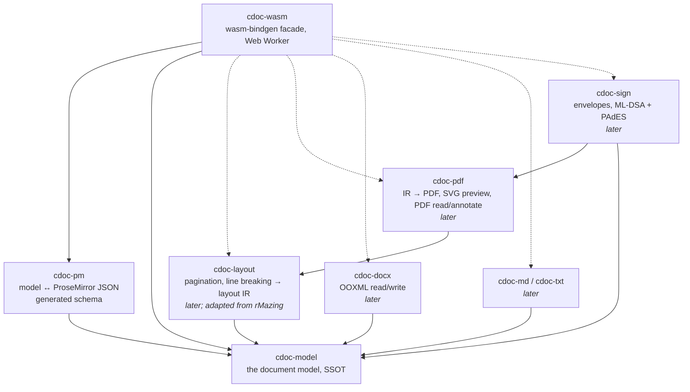

# Architecture

Citadel Docs is a set of pure Rust crates compiled to WASM. "Pure" is literal: a core crate
performs no I/O, reads no clock, draws no randomness and touches no global state. Whatever it
needs from the world (font bytes, image bytes, the time, a fresh id) comes in through a port the
caller implements. This is SBIO: business logic on one side, I/O on the other, with a trait in
between. It is why the cores are testable without mocks and why the same binary runs in a Web
Worker, a CLI and a server.

## Crate graph



Arrows point at dependencies. `cdoc-model` depends on nothing but `serde` and `thiserror`.
Nothing depends on `cdoc-wasm`.

## cdoc-model: the single source of truth

A `Document` is a tree:

```
Document
├── meta, settings
├── styles: StyleSheet { defaults, styles: [Style] }      ← the cascade
├── numbering: { definitions: [AbstractNumbering], instances: [NumberingInstance] }
├── sections: [Section]
│   ├── properties: page setup, headers {default, first, even}, footers {…}, start, title_page
│   └── blocks: [Block = Paragraph | Table]
│       ├── Paragraph { properties, inlines: [Inline] }
│       │     Inline { content, marks }
│       │       content: Text | Image | Break | Tab | FootnoteRef | Field | FormField | SignatureField
│       │       marks:   link, comments[], revision (insertion | deletion)
│       └── Table { properties, column_widths, rows: [Row { cells: [Cell { blocks }] }] }
├── footnotes: [Footnote { id, blocks }]
└── comments:  [Comment { id, author, date, text, resolved, parent }]
```

Design decisions other crates rely on:

- **Units are Word's integers.** `Length` is hundredths of a point (`Pt100`, the unit the
  layout IR already uses, so model → layout needs no conversion), `FontSize` is half-points,
  `BorderWidth` is eighths of a point, table percentages are fiftieths of a percent. A `.docx`
  value survives a round trip unchanged; no floats cross a serialisation boundary.
- **Every property is `Option`.** `None` inherits through the cascade; `Some(false)` explicitly
  turns an inherited property off. `RunProperties::none()` / `ParagraphProperties::none()` are
  the named empty values; there is no `Default` on configuration-like types.
- **The cascade is a function, not a cache.** `StyleSheet::resolve_run(paragraph_props,
  run_props)` and `resolve_paragraph(props)` walk `based_on` chains (defaults → paragraph
  style → character style → direct) and return the effective properties. Cycles and unknown
  styles are `StyleError`s.
- **Lists are flat.** A paragraph carries `numbering: { num_id, level }`; the definitions live
  in `Document.numbering`. This is Word's model and the only one `.docx` round-trips. Labels
  (`1.`, `1.1`, `•`) are computed, never stored.
- **Range annotations are marks.** Hyperlinks, comment anchors and tracked changes sit on each
  inline, not as containers, so they map one-to-one to ProseMirror marks and overlapping
  comments need no tree surgery. The `.docx` writer groups adjacent inlines with equal marks.
- **Merged cells are spans.** `col_span` / `row_span` on the top-left cell, as ProseMirror and
  HTML do; `.docx`'s `gridSpan` / `vMerge` is the writer's problem.
- **Validation is total.** `Document::validate()` returns *every* defect (`Vec<ValidationError>`),
  so an importer can report them all. A valid document is one every exporter and the layout
  crate can take without defensive code.
- **Walkers are shared.** `Document::blocks()`, `paragraphs()`, `inlines()`,
  `run_properties()` reach headers, footers, footnotes and nested cells, so no crate re-derives
  the containment rules. `word_count()` is built on them.
- **Test support ships with the model.** Behind the `test-support` feature:
  `test_support::strategies` (proptest generators for every type, boxed so deep trees do not
  overflow the stack) and `test_support::fixtures::kitchen_sink()` (valid, uses every variant
  once, including a nested table and all three header kinds). Dependent crates test round trips
  against these rather than writing generators of their own.

## cdoc-pm: the editor's schema, generated

`to_pm` / `from_pm` map the model to ProseMirror JSON losslessly (`from_pm(to_pm(d)) == d`
for every generated document). The mapping rules:

| Model | ProseMirror |
|---|---|
| `Document` | `doc` node; `meta`, `settings`, `styles`, `numbering`, `comments` as attrs |
| `Section` | `section` node; `start`, `page`, `titlePage` attrs; `header`/`footer` children first, then blocks |
| `Paragraph` | `paragraph`; **attrs are exactly the serde fields of `ParagraphProperties`** |
| `Table` / row / cell | `table` (+`columnWidths`), `tableRow`, `tableCell` / `tableHeader` with `colspan`/`rowspan` (prosemirror-tables' spelling) |
| `Text` run | `text` node; `RunProperties` → marks (`bold{on}`, `textStyle{fontFamily,fontSize,color}`, …) |
| other inlines | atoms: `image`, `hardBreak`, `pageBreak`, `columnBreak`, `tab`, `footnoteRef`, `field`, `formField`, `signatureField` |
| `Marks` | `link`, `comment{id}` (repeatable), `insertion`/`deletion{id,author,date}` |
| `Footnote` | `footnotes` > `footnote{id}` at the end of `doc` |

**Schema-sync mechanism.** `cdoc_pm::schema::schema()` builds the schema as data from the same
name constants (`names.rs`) the encoder and decoder use, with attribute lists taken from the
serde field names of fully populated model values (`schema/full.rs`). It is checked in as
`schema/prosemirror-schema.json` (snapshot test), exported by `cdoc-wasm::schema_json()`, and
every encoded document is verified against it by `schema::check` inside the round-trip property
tests. The UI compares its TipTap `editor.schema` to the same JSON in a vitest
(`docs/tiptap-schema.md` § Drift gate). A field added to the model therefore fails CI in
`cdoc-pm` until the schema knows it, and fails CI in the UI until the extension knows it.

## Ports (for the later crates)

The cores take the world through traits the caller implements. Names are proposals for the
crates that need them; `cdoc-model` and `cdoc-pm` need none.

| Port | Used by | Shape |
|---|---|---|
| `FontPort` | layout, pdf | `fn face(&self, family: &str, bold: bool, italic: bool) -> Result<&[u8], FontError>` — bytes of a font file; the layout crate parses and measures (rMazing `fonts.rs` pattern, `allsorts` for subsetting) |
| `ImagePort` | layout, pdf, docx | `fn image(&self, id: &ContentId) -> Result<ImageBytes, ImageError>` — bytes plus declared MIME; decoding stays in the core |
| `ClockPort` | sign, UI glue | `fn now_rfc3339(&self) -> String` — the model stores dates as text; only the signing crate needs the time, for audit events |
| `IdPort` | UI glue, sign | `fn fresh_id(&self) -> String` — comment, field and revision ids; the browser supplies `crypto.randomUUID()` |

In the browser the WASM facade is the only place these are wired, from JS, inside the Web
Worker. In tests they are plain structs. Never implement a port by calling `std::fs`,
`std::time` or `getrandom` from inside a core crate; `scripts/dep-gate.sh` forbids those crates
in the wasm32 build.

## cdoc-wasm

A thin layer: every export is one line over `facade.rs`, which is string-in string-out JSON and
tested natively. Inputs and outputs are JSON text: the browser has a parser, nothing in the
payload is a `BigInt`, and one ABI type keeps the boundary trivial. Built for
`wasm32-unknown-unknown` only (never WASI). The CI gate checks the artefact imports nothing but
wasm-bindgen's own glue modules.

## Collaboration layer

The UI's editor is TipTap v2 over Yjs (`y-prosemirror`). y-prosemirror syncs the document
*fragment*, not the top-level `doc` node's attributes, so in the live editor the document-level
attrs (`meta`, `settings`, `styles`, `numbering`, `comments`) live in `ydoc.getMap('cdoc')`
under the same keys, and the UI bridge assembles a full `doc` node (fragment + map) before
calling `cdoc-wasm`. The mapping in `cdoc-pm` is unaffected; the JSON shape is the interchange
format on both sides.

## Later crates: how they build on the model

- **cdoc-layout** consumes a `Document`, resolves every paragraph and run through
  `StyleSheet::resolve_*`, and emits a layout IR of pages. Reuse from rMazing
  (`~/rMazing/crates/cc-export/src/layout/`): `ir.rs` (`Pt100`, `Rgb`, `Draw`, `Page` — the
  same unit as `Length`), `line.rs` and `flow.rs` (lines set downwards with keep-together
  rules), `wrap.rs` (measured wrapping), `fonts.rs` (faces parsed once, glyph advances,
  `sanitise`). Each copied file carries a provenance header; see Licensing. What changes:
  `Face` becomes a resolved `(family, bold, italic)` from the cascade rather than four fixed
  faces, `Geometry` comes from `PageSetup`, and columns, headers/footers and footnotes are new.
  Layout writes `SignatureField.anchor` (`PageAnchor`) so signing knows where a field landed.
- **cdoc-pdf** renders the IR (`pdf-writer`, no C) and the SVG preview from the same IR, so
  preview and file cannot disagree (rMazing's two-backend pattern).
- **cdoc-docx** reads/writes OOXML with `quick-xml` + `zip` (deflate only). The model's units
  are OOXML's, so the mapping is arithmetic-free except `Length::from_twips`.
- **cdoc-sign** owns envelopes and signatures; from the model it needs only `SignatureField`
  (`id`, `signer_role`, `anchor`) and the document digest.
- **cdoc-md / cdoc-txt** are lossy by nature; they map onto the built-in styles
  (`builtin::ids::heading(n)`, `quote`, …) and flat numbering.

## Repository rules

- Every file ≤ 250 lines (`scripts/check-file-length.sh`, in CI). Split, never exempt.
- clippy 1.99 pedantic with `-D warnings`, rustfmt clean, `#![forbid(unsafe_code)]`.
- TDD with a negative control per fix: break the code, see the test go red, restore, verify
  the file by checksum. Controls that stay green are discarded, not reported.
- No `Default` on config-like types; named constructors (`Document::blank()`,
  `StyleSheet::word_builtin()`, `PageSetup::a4_normal()`) make the choice visible at the call
  site.
- Dependencies: MIT / Apache-2.0 / BSD only; no `ring`, OpenSSL, `*-sys`, randomness or clock
  crates in the wasm32 build (`scripts/dep-gate.sh`).

## Licensing

`MIT OR Apache-2.0`, matching the Citadel SDK (`citadel_sdk` is `MIT OR Apache-2.0`;
`citadel-internal-service` is MIT; `intersession-layer-messaging` is Apache-2.0; the
`citadel-workspace` parent and the UI carry no licence file). Dual licensing is the superset
that every one of those can consume.

The rMazing `cc-export` layout sources are AGPL-3.0 in their home repository. Their sole
copyright holder (Thomas Braun) has approved copying them into this repository under
`MIT OR Apache-2.0`. Each adapted file starts with:

```
// Adapted from rMazing crates/cc-export/src/layout/<file>.rs
// Copyright (c) Thomas Braun. Relicensed MIT OR Apache-2.0 by the copyright holder, 2026-10-04.
```
